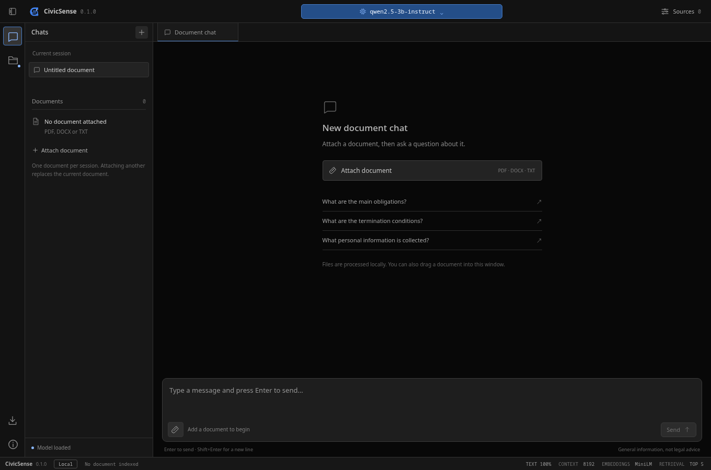
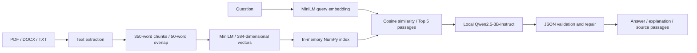

<p align="center"></p>
<h1 align="center">CivicSense Desktop</h1>
<p align="center">A local desktop application for understanding civic and legal documents.</p>
<p align="center"><a href="https://github.com/Hari-Sri-T/CivicSense-Desktop/releases">Download desktop app</a> · <a href="paper/conference_final.tex">Paper</a> · <a href="docs/RESEARCH.md">Research reproduction</a> · <a href="docs/EVIDENCE_AUDIT.md">Evidence audit</a></p>

Upload a **PDF, DOCX or TXT**, ask a question, and inspect the answer alongside the passages retrieved from your document. CivicSense runs the generation model and document embeddings on your computer. Its interface follows a local-model workflow inspired by LM Studio, with a model selector, loading status, document chat and an evidence panel.

**The packaged app does not need Python, LM Studio, an API key, or a separate model server.** On first launch it automatically downloads **Qwen2.5-3B-Instruct Q4_K_M** (about 2.1 GB) and **all-MiniLM-L6-v2**, loads them, and opens the workspace. Later launches reuse the downloaded files. Initial setup needs internet; cached models can run offline.



## Download and run — no Python installation

Open [GitHub Releases](https://github.com/Hari-Sri-T/CivicSense-Desktop/releases) and choose the package matching your operating system and processor. The first desktop release is a **preview**. Download availability is determined by the release assets; a source ZIP is not an executable app.

| Computer | Package | How to start |
|---|---|---|
| Windows 10/11, x64 | `CivicSense-Windows-x64-Setup.exe` | Run the installer, then open CivicSense from the Start menu. Installation is per user. |
| Windows 10/11, x64 — portable | `CivicSense-Windows-x64.zip` | Extract the whole ZIP, then open `CivicSense/CivicSense.exe`. Keep `_internal` beside the executable. |
| macOS 14+, Apple Silicon | `CivicSense-macOS-arm64.dmg` | Open the disk image, drag `CivicSense.app` to Applications, then open it. A ZIP containing the `.app` is also provided. |
| Linux, x64 | `CivicSense-Linux-x64.tar.gz` | Extract the archive and run `CivicSense/CivicSense` from the extracted folder. |

For Linux, the terminal commands are:

```bash
tar -xzf CivicSense-Linux-x64.tar.gz
cd CivicSense
./CivicSense
```

The Linux release is built on Ubuntu 22.04 and targets compatible graphical desktops with glibc 2.35 or newer. The macOS package is for **Apple Silicon**, not Intel Macs. Windows needs Microsoft's [WebView2 Runtime](https://developer.microsoft.com/en-us/microsoft-edge/webview2/), which may already be present. These packages include native libraries; they are not interchangeable across operating systems or processor architectures.

Preview packages are unsigned, so Windows or macOS may ask you to verify the publisher. Obtain them from this repository's Releases page and compare the supplied `SHA256SUMS.txt`; do not disable operating-system protections. Each package passes a native dependency/resource self-check before publication. Interactive behavior still needs validation on your hardware.

### First launch

1. Open CivicSense with internet available.
2. The branded loading screen prepares Qwen and MiniLM. Follow the status text; first launch can take several minutes depending on your connection and computer.
3. If setup fails, use **Retry setup** or **Open model settings** to inspect the error. An interrupted download can be retried.
4. When the workspace opens, attach a PDF, DOCX or TXT file, up to **25 MB**.
5. Ask a question and inspect **Sources** to read the passages used for the latest answer.

There is no need to download GGUF files manually, clone an embedding-model repository, or start LM Studio for normal use. The default is the paper's selected Qwen model; the app does not silently choose a different model or send questions to a cloud model.

### System requirements and storage

Use a modern 64-bit desktop with **at least 8 GB RAM; 16 GB is preferable**, and several GB of free space for the app, model files, and temporary downloads. A dedicated GPU is not required: portable builds use CPU inference. Large documents and other running applications increase memory demand. Generation speed varies by machine; the historical paper latency is not a promise for these packages.

Models are stored outside the application directory:

| OS | Default model cache |
|---|---|
| Windows | `%LOCALAPPDATA%/CivicSense` |
| macOS | `~/Library/Application Support/CivicSense` |
| Linux | `$XDG_DATA_HOME/CivicSense`, or `~/.local/share/CivicSense` |

Set `CIVICSENSE_DATA_DIR` to use a different location. Replacing or uninstalling the application does not automatically remove this cache. For strict offline use after successful initial setup, set `HF_HUB_OFFLINE=1`; missing cached files will then produce a visible error rather than a network lookup.

## Run from source

Use **64-bit Python 3.12** and Git. This is an alternative to the packaged app.

```bash
git clone https://github.com/Hari-Sri-T/CivicSense-Desktop.git
cd CivicSense-Desktop
```

### Windows — PowerShell

Using the environment's interpreter directly avoids activation-policy changes:

```powershell
py -3.12 -m venv .venv
.\.venv\Scripts\python.exe -m pip install --upgrade pip
.\.venv\Scripts\python.exe -m pip install torch --index-url https://download.pytorch.org/whl/cpu
.\.venv\Scripts\python.exe -m pip install -r requirements-desktop.txt --extra-index-url https://abetlen.github.io/llama-cpp-python/whl/cpu
.\.venv\Scripts\python.exe desktop.py
```

### Linux

```bash
python3.12 -m venv .venv
.venv/bin/python -m pip install --upgrade pip
.venv/bin/python -m pip install torch --index-url https://download.pytorch.org/whl/cpu
.venv/bin/python -m pip install -r requirements-desktop.txt 'pywebview[qt]' --extra-index-url https://abetlen.github.io/llama-cpp-python/whl/cpu
.venv/bin/python desktop.py
```

### macOS — Apple Silicon

Install Xcode command line tools first if they are absent (`xcode-select --install`). The current macOS inference-engine wheel is corrupt, so this setup builds the same version from source:

```bash
python3.12 -m venv .venv
.venv/bin/python -m pip install --upgrade pip
CMAKE_ARGS="-DGGML_METAL=OFF" CMAKE_BUILD_PARALLEL_LEVEL=3 .venv/bin/python -m pip install --no-cache-dir --no-binary=llama-cpp-python llama-cpp-python==0.3.36
.venv/bin/python -m pip install -r requirements-desktop.txt --extra-index-url https://abetlen.github.io/llama-cpp-python/whl/cpu
.venv/bin/python desktop.py
```

If a prebuilt `llama-cpp-python` wheel is unavailable for your platform, pip may compile it. Source builds require a C/C++ toolchain and CMake; on macOS, install Xcode command line tools. Linux also needs Qt and its system dependencies. See [desktop setup and troubleshooting](docs/DESKTOP.md).

The browser fallback uses the same local pipeline. Add `--browser` to the launch command, for example:

```bash
.venv/bin/python desktop.py --browser
```

No `.env` file is required. Optional settings are in [.env.example](.env.example). The optional `CIVICSENSE_BACKEND=lmstudio` mode is retained for research experiments; normal users should keep the embedded default.

## Try a document

Use [the fictional demonstration policy](examples/sample_policy.txt), also included in desktop packages:

- “How much notice is required to cancel membership?” — the policy says seven days' written notice.
- “What personal information is collected?” — inspect the policy's name/email and reservation-record provisions.
- “What parking arrangements does the policy describe?” — the document does not specify them.

The app shows an answer, an explanation, and retrieved passages with source metadata. These passages support human inspection; CivicSense does not automatically verify that every generated claim or source citation is correct. Always read the document before relying on an answer. This is general information, not legal advice.

### Workspace behavior and keyboard shortcuts

- One active document. Successfully attaching another replaces the index and clears the displayed chat; a failed upload preserves the current document.
- Temporary uploaded files are deleted after indexing. Extracted text, vectors and displayed conversation remain in memory until the app closes. There is no persistent chat library.
- Questions are independent: previous chat messages are not sent to the model as conversational memory.
- **Ctrl +** or **Ctrl =** increases text size; **Ctrl −** decreases it; **Ctrl 0** resets it. Cmd equivalents work too. Text size ranges from 70% to 200% for the current window.
- **Enter** sends a question; **Shift+Enter** inserts a newline. **Ctrl/Cmd K** starts a new workspace.
- Scanned PDFs need OCR before upload. Password-protected, damaged or exceptionally large documents may fail parsing or exceed available memory/context.

## How CivicSense works



| Component | Implementation |
|---|---|
| Desktop window | pywebview; native WebView2/WebKit or Qt |
| Local backend | Flask on `127.0.0.1`, with a temporary desktop port |
| Document parsing | PyMuPDF, python-docx, UTF-8 text |
| Chunking | Sequential whitespace-based word chunks, 350 words with 50 overlap |
| Embeddings | `sentence-transformers/all-MiniLM-L6-v2`, CPU, 384 dimensions |
| Retrieval | In-memory NumPy index, brute-force cosine similarity, Top 5 |
| Generation | `Qwen/Qwen2.5-3B-Instruct-GGUF`, Q4_K_M, embedded llama-cpp-python |
| Generation settings | 8192-token context, temperature 0.1, up to 4096 output tokens |
| Output | Validated `answer` and `explanation` strings, plus retrieved text and metadata |

The Qwen repository revision is pinned in [model_runtime.py](model_runtime.py). The system prompt directs the model to use only supplied sources, abstain when evidence is insufficient, and treat instructions inside documents as untrusted content. These are prompting measures, not a guarantee against factual errors or prompt injection.

Document text and questions are processed locally. Initial model downloads contact the model publisher's infrastructure; document content is not sent there by this application. The backend is for a **single local user**, not a shared or network-facing deployment.

## Paper and research

Associated manuscript: **CivicSense AI: An Explainable Retrieval-Augmented Generation System for Public Document Understanding**.

The supplied author list is Hari Sri Shanmukha Sai Tanniru, Sahil Awatramani, Tanishq Sangle, Sheetal Kusal, and Supriya Mahadevkar. [CITATION.cff](CITATION.cff) contains repository citation metadata. No publication DOI is supplied in this repository.

The research studies a local, lightweight document-understanding pipeline through embedding comparisons, chunk/overlap experiments, model comparisons, prompt restrictions, a larger evaluation and exploratory security checks. Qwen2.5-3B was selected for reliability among the tested configurations.

| Saved Phase 3 Qwen measure | Value |
|---|---:|
| Queries | 500, across four LegalBench-RAG subsets |
| Valid answers | 495 |
| Operational error rate | 1.0% |
| BERTScore F1, valid answers | 0.8460 |
| Corpus BLEU | 14.0192 |
| Corpus chrF | 31.5366 |
| Token F1 | 28.96% |
| Recall@5, document-path metric | 99.6% |
| MRR | 0.996 |
| Original mean latency | 18.3985 s |

These values come from [the saved Phase 3 artifact](model_results/result_v3_qwen_unrestricted.json). They describe historical LM Studio experiments, **not a benchmark of the packaged desktop release**. The evaluation indexed the ground-truth document individually and checked retrieved file paths, so the high document-path recall does not establish answer-span retrieval accuracy. Quality metrics were calculated on valid answers. Original hardware and quantization notes are discussed in the audit.

Read [EVIDENCE_AUDIT.md](docs/EVIDENCE_AUDIT.md) before quoting paper claims. It records conflicts in retrieval/hardware claims, limited security-dataset provenance, and differences between earlier and later experiments. The saved security judge labels do not establish universal prompt-injection resistance. BERTScore and JSON validity do not establish factual correctness.

Research files:

- [Final supplied manuscript](paper/conference_final.tex), [paper directory](paper/) and [master evaluation report](paper/Master_Evaluation_Report.md).
- [Research reproduction guide](docs/RESEARCH.md): dataset layout, LM Studio research mode and experiment commands.
- [Project map](docs/PROJECT_MAP.md): current application, historical scripts, results and legacy experiments.
- [Conference outline](docs/CONFERENCE_OUTLINE.md): starting point for the later presentation.
- [Validation record](docs/VALIDATION.md): what has actually been tested.

The supplied manuscript references six figure images absent from the original workspace; it cannot compile as supplied until those assets are recovered or recreated. Paper notes and raw results are preserved unchanged for traceability.

## Build desktop packages

Build on the target OS; PyInstaller does not cross-compile Windows, macOS and Linux applications. In an activated Python 3.12 environment:

```bash
# On Windows/Linux, install CPU Torch first as shown above.
python -m pip install -r requirements-build.txt --extra-index-url https://abetlen.github.io/llama-cpp-python/whl/cpu
# Linux only:
python -m pip install 'pywebview[qt]'
python scripts/build_desktop.py
python scripts/package_desktop.py --version 0.1.0-preview.2
```

Windows installer creation also requires Inno Setup 6. macOS disk images use `hdiutil`; Linux archives use Python's tar support. The build bundles Python and runtime dependencies, **not model weights, credentials or personal documents**. The app downloads model weights into the user's cache when needed.

The [desktop release workflow](.github/workflows/desktop.yml) builds on Windows, macOS and Linux, checks each frozen executable, packages it, and uploads archives/diagnostics to Actions. Pushing a `v*` tag publishes a preview release after all platform builds pass. A manual workflow run produces downloadable Actions artifacts without publishing a release. Signing/notarization requires publisher credentials and is not configured.

## Development and checks

```bash
python -m pip install -r requirements-test.txt
python -m pytest -q
python scripts/check_release.py
```

The core tests substitute model responses and embeddings and do not download weights. The optional browser checks require `playwright` and `python -m playwright install chromium`; they cover appearance, text resizing and startup transitions. [Validation details](docs/VALIDATION.md) distinguish those from real-model checks.

A source or packaged app also supports diagnostics:

```bash
python desktop.py --self-test --self-test-report check.json
# Optional: download/load the real models and run a document question.
python desktop.py --self-test --with-models --self-test-report model-check.json
```

For a packaged executable, replace `python desktop.py` with its path. The default self-test checks resources, native model bindings, PDF extraction and JSON handling without downloading model weights.

The research API retains `/upload`, `/query`, `/clear_index` and `/load_file`; `/api/status` exposes preparation state. `/load_file` can only read within `CIVICSENSE_EVALUATION_ROOT`, defaulting to `LegalBench-RAG/corpus`. Foreign browser origins are rejected. See [.env.example](.env.example) and [research setup](docs/RESEARCH.md) for configuration.

## Licenses and publication

Read [THIRD_PARTY_NOTICES.md](THIRD_PARTY_NOTICES.md). In particular, this Qwen 3B model uses the publisher's **Qwen Research License**; PyMuPDF has AGPL/commercial licensing. Dependency license files are collected into desktop packages. Models and third-party corpus data are obtained separately under their publishers' terms.

The repository excludes secrets, service-account files, uploads, virtual environments, downloaded model weights and third-party corpus files. The supplied manuscript and figures retain their existing ownership. A public repository is not itself a license grant for the authors' original code; project authors still need to select that license before advertising the project as open source.
